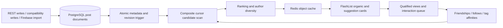

# Diverse feed deployment — 18 September 2026

The Laravel backend owns candidate selection, ranking, author diversity, suggestion slots, visibility, and pagination. The mobile client preserves that order and renders the existing post cards through FlashList. This adapts the supplied Node/PostgreSQL examples to the application's actual Laravel and compatibility-document architecture.



## Backend structure

Backend root: `D:/celeone_v1_backend`.

| File | Responsibility |
| --- | --- |
| `app/Http/Controllers/Api/V1/FeedController.php` | Authenticated feed, card refresh, interaction APIs |
| `app/Services/Feed/FeedService.php` | Snapshot, keyset scan, deferred candidates, ranking and cursor replay |
| `app/Services/Feed/FeedAudience.php` | Native and migrated relationships; owner/friends/public visibility |
| `app/Services/Feed/FeedMixer.php` | Author streaks, soft page cap and suggestion slots |
| `app/Services/Feed/FeedObjectCache.php` | Redis multi-get, one bulk query for misses, revision keys |
| `app/Services/Feed/FeedInteractions.php` | Idempotent events and decaying tag affinity scores |
| `database/sql/feed_metadata.sql` | PostgreSQL metadata/revision trigger for every write path |
| `database/migrations/2026_09_18_000300_add_diverse_feed.php` | Columns, indexes, cursors, affinities and interactions |
| `config/feed.php` | Candidate limits, diversity rules and TTLs |
| `app/Console/Commands/BackfillFeedPosts.php` | Mirrors SQL-only posts without overwriting imported posts |
| `app/Console/Commands/PruneFeedData.php` | Expires cursors and removes events older than 30 days |

Posts remain in the existing `firebase_documents` compatibility store. Indexed metadata avoids loading full post bodies during ranking. The trigger normalizes author/owner/page IDs, status, visibility, timestamps, tags, popularity and payload revision. REST writes and imports therefore use the same feed index.

## Selection and pagination

- Default page size: 20; accepted range: 1–50. The first page fixes the size for its cursor chain.
- Fetch up to 200 candidates (at least five times the page size), using `(created_at_ms, document_id)` as the descending composite boundary.
- Snapshot the maximum source row ID and timestamp. New posts appear after refresh, rather than shifting an active feed.
- Preserve all unselected IDs in the cursor. An additional window-function scan can reach up to 60 posts from other authors beyond a concentrated burst; an ahead-ID ledger prevents those posts appearing again when the ordinary scan reaches them.
- Rank by relationship, decaying tag affinity, popularity and freshness. Cold-start discovery uses public posts and popularity/freshness.
- Allow at most two consecutive posts by one author while alternatives exist. Prefer at most three per author per page; relax this soft cap when other authors are exhausted so remaining posts are still accessible.
- Every fourth post position is eligible for a suggestion. Suggestions are distinct public posts, with `feedItemType: SUGGESTION`; ordinary cards use `ORGANIC_POST`. Existing non-post rails do not count toward these post positions.
- Cursors are opaque UUIDs bound to the authenticated user, expire after two hours, and store their result for repeatable retries. Cross-page author streak and slot position are retained. Deleted or newly private posts are filtered even on replay.

Changing existing posts' creation timestamps during a scroll is outside snapshot guarantees. Normal post edits preserve creation time. Diversity cannot manufacture additional authors when the available pool contains only one author.

## API contract

All endpoints use the existing Laravel Sanctum bearer token. The server derives the user identity from that token.

`GET /api/v1/feed?limit=20&cursor=<optional UUID>`

```json
{
  "ok": true,
  "data": [{"id":"post-id","feedItemType":"SUGGESTION","feedReason":"discovery"}],
  "nextCursor": "opaque-uuid-or-null",
  "hasMore": true,
  "snapshotAt": 1789736400000
}
```

Expired or foreign cursors return 410 and require refresh. Invalid inputs return 422.

`POST /api/v1/feed/items` with `{"ids":["post-id"]}` refreshes up to 50 accessible cards without reranking. Missing, deleted and inaccessible posts are omitted.

`POST /api/v1/feed/interactions` accepts up to 50 events:

```json
{
  "actorUid":"current-public-user-id",
  "events":[{"eventId":"unique-event-id","postId":"post-id","type":"VIEW","durationMs":2000}]
}
```

Supported types: `VIEW`, `CLICK`, `LIKE`, `COMMENT`, `SHARE`, `SAVE`, `WATCH`, `SKIP`. The response reports `accepted`. Events are deduplicated by event ID and by user/post/type/day. VIEW and WATCH require at least two seconds. Tags come from the stored post, never from the submitted event. Scores decay by 2% per day, retain at most 100 tags, and cap each score at 1000. This is a lightweight heuristic recommender, not a trained recommendation model.

## Cache and mobile behavior

Redis stores each post at `feed:post:{id}:{revision}` for 24 hours, behind Laravel's cache prefix. Reads use multi-get and a single bulk PostgreSQL query for misses. Every payload edit changes its revision atomically; old entries become unreachable and expire naturally. Deletes and visibility changes are checked against PostgreSQL before hydration. Redis failures fall back to PostgreSQL.

`src/feed/useServerFeed.ts` handles cursor loading, duplicate suppression, account changes, expired cursors and a per-account cached first page (24-hour maximum age). The in-memory list retains the latest 400 cards. Pull-to-refresh starts a new snapshot. When focused, up to eight visible cards refresh every 15 seconds without reordering; this is polling, not WebSocket delivery.

Local likes, comments, shares, edits and deletions update this same feed state immediately. Failed optimistic reactions roll back. Publishing starts a fresh snapshot so the new post is visible.

`src/feed/interactions.ts` persists a bounded per-account event queue, batches 50 events, and retries on foreground or later interactions. Both existing Social screen copies use 70% visibility for at least two seconds, separate FlashList recycling types, suggestion styling, and prefetch the next four cards' thumbnails/avatars using the existing native image cache.

## Deployment and validation

Live backend: `/var/www/celeone-backend` → release `2026.09.18.1`. New routes are enabled and PHP-FPM was reloaded. The PostgreSQL database uses a different session timezone from Laravel; feed timestamptz writes and cleanup comparisons explicitly include the timezone.

Deployed source directories use mode 755 and source files use 644. The archive packager normalizes Windows file modes accordingly. Runtime storage and credential permissions are managed separately.

The production database runtime role does not own the legacy tables. `deploy/feed-migrate.php` applies this migration transactionally through local PostgreSQL owner access and grants only the required runtime DML/sequence rights. Normal environments with a migration owner can run the migration with Artisan.

`celeone-feed-prune.timer` runs `php artisan feed:prune` hourly as www-data. The Artisan scheduler also declares the command for environments that use `schedule:run`. Firebase sync remains active every minute.

Validation completed:

- Feed and Firebase import regression suite: eight tests, 45 assertions.
- Production PostgreSQL/Redis probe: 233 private synthetic posts, full unique traversal, author lookahead, tied timestamps, new-post snapshot isolation, retries, privacy, edited/deleted cache objects, event deduplication and tag scoring.
- Public HTTPS probe: authenticated feed envelope, pagination/retry, visible-card refresh and interaction API.
- Probe accounts, posts, tokens, interactions, affinities and cursors were removed or rolled back. No real-user notifications were sent.

The full mobile TypeScript check reports existing repository errors; it is not a clean project-wide check. Both the initial and final feed comparisons introduced no additional errors in the feed, backend client or Social modules. Physical-device audio and status-bar notification display remain device-level validation steps.

Repeatable probes: `deploy/feed-verify.php` and `deploy/feed-http-verify.php`. The HTTP probe briefly creates an isolated account/private post and removes them in its cleanup block.

Backups: `/root/releases/comms-fix-20260918/before-feed.dump` and `before-feed-code.tar.gz`. For a code rollback, restore the prior controllers/routes, rebuild route/config caches, and reload PHP-FPM. Leave the additive schema in place until compatibility is verified; do not restore a full database backup over newer user activity.

Communications deployment and device-validation limits are documented in `COMMUNICATIONS-DEPLOYMENT.md`.

## Android release build

### Video browsing policy

Social posts and Cele Vibes/reels use static video covers while browsing. New generated covers request the frame at five seconds; short clips clamp to just before their end. `VideoThumbnailPackage.kt` registers Android's `VideoThumbnail` module and extracts JPEG frames off the UI thread. `src/media/VideoPoster.tsx` extracts and caches missing covers for legacy videos; existing saved/custom covers are preserved. Both Social screen copies use the same policy.

Pointer hover starts inline playback; leaving stops it. Mobile users tap to open/play a clip. Swiping to another full-screen reel leaves that reel paused until interaction. Paused frame seeks do not count as watched video. Editor previews and explicitly opened social-video playback retain their separate controls.

These follow-up changes require a new Android build to include the native thumbnail module; the artifact recorded below predates this follow-up.

Gradle's React Native bundle inputs and Metro exclude generated repository caches and backups, including `.gradle-user-home`, `.tmp*`, and the nested PostDetail server functions. These directories caused long Windows source scans. Metro uses two workers to limit memory pressure.

From `android`, build the app target with:

```powershell
.\gradlew.bat :app:assembleRelease --max-workers=2 '-Dorg.gradle.jvmargs=-Xmx3g -XX:MaxMetaspaceSize=768m -Dfile.encoding=UTF-8'
```

The release uses the existing configured signing key; credentials remain in the existing local signing configuration.

The release assembly reported `BUILD SUCCESSFUL`; APK signature verification and bundled feed feature checks passed. Artifact: `android/app/build/outputs/apk/release/app-release.apk` (122,029,676 bytes; SHA-256 `21cb440f3efd7757aa021702d8ac0551de0b647716a6f773e9254aec83669961`). It includes arm64-v8a and armeabi-v7a. A separately debug-signed copy matching the connected TECNO phone was installed with `adb install -r`, preserving app data. Cold launch and rendering of the live social feed/recommendation cards passed. The original release artifact retains its production signing certificate.
